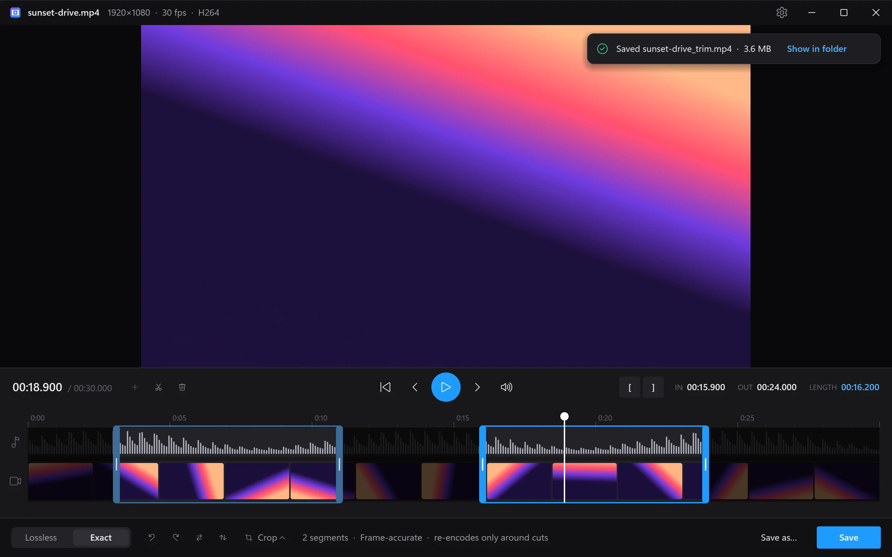

  

<h1 align="center">VidTrim</h1>

  <b>Trim any video from the right-click menu.</b> 
  A tiny, native Windows app: right-click a video, drag the handles, save.

  <a href="https://github.com/adamcfranco/vidtrim-releases/releases/latest/download/VidTrimSetup.exe"><b>Download for Windows</b></a>
  &nbsp;·&nbsp;
  <a href="https://adamcfranco.github.io/vidtrim-releases/">Website</a>
  &nbsp;·&nbsp;
  <a href="https://github.com/adamcfranco/vidtrim-releases/releases">Release notes</a>

  

## Features

- **Right-click → Trim...** on MP4, MKV, MOV, WebM, AVI and 25+ other video types.
- **Lossless** cuts copy the original streams: no re-encode, no quality loss, done in seconds. The timeline marks the keyframe each cut starts from.
- **Exact** cuts start and end on the exact frame. For H.264 and HEVC it's a smart cut: only the frames around each cut are re-encoded and everything in between is copied untouched. Other formats re-encode on your GPU (NVIDIA NVENC, AMD AMF, Intel Quick Sync, or Media Foundation).
- **Cut out the middle**: split at the playhead and delete parts, or keep several highlights. The kept parts are joined into one file.
- **Rotate and flip** without re-encoding (written as orientation metadata), and **crop** to 9:16, 4:5, 1:1 or 16:9 (re-encodes).
- **Copy frame**: right-click the video or press <kbd>Ctrl</kbd> + <kbd>C</kbd> to copy the current frame at full resolution.
- Plays almost anything with hardware decoding: H.264, HEVC 10-bit, AV1, VP9, ProRes and more, up to 4K60, with HDR tone-mapped for preview.
- Filmstrip and waveform timeline with zoom, frame stepping and keyboard shortcuts.
- Audio follows your output device and compensates for Bluetooth latency; the delay is adjustable for each device.
- Native C++ / Direct3D 11. The executable is under 1 MB and opens instantly.

## Install

1. Download [`VidTrimSetup.exe`](https://github.com/adamcfranco/vidtrim-releases/releases/latest/download/VidTrimSetup.exe) (Windows 10 or 11, 64-bit).
2. Run it and click **Install**. It installs for your account only, so no admin rights are needed.
3. Right-click any video and choose **Trim...**. In Windows 11 File Explorer it's under **Show more options**.

> **SmartScreen:** the installer isn't code-signed yet, so Windows may say "Windows protected your PC". Click **More info** → **Run anyway**.

To uninstall, go to **Settings → Apps → Installed apps → VidTrim → Uninstall**. This removes the app, its menu entry and its settings.

## Keyboard

| Action | Keys |
|---|---|
| Play / pause | <kbd>Space</kbd> |
| Play the selection | <kbd>Enter</kbd> |
| Step one frame | <kbd>←</kbd> <kbd>→</kbd> |
| Jump one second | <kbd>Shift</kbd> + <kbd>←</kbd> <kbd>→</kbd> |
| Set in / out at the playhead | <kbd>I</kbd> <kbd>O</kbd> |
| Split at the playhead | <kbd>S</kbd> |
| Remove the selected segment | <kbd>Del</kbd> |
| Keep a removed part again | <kbd>A</kbd> |
| Rotate right / left | <kbd>R</kbd> / <kbd>Shift</kbd> + <kbd>R</kbd> |
| Flip horizontal / vertical | <kbd>H</kbd> / <kbd>V</kbd> |
| Copy frame | <kbd>Ctrl</kbd> + <kbd>C</kbd> |
| Save / Save as | <kbd>Ctrl</kbd> + <kbd>S</kbd> / <kbd>Ctrl</kbd> + <kbd>Shift</kbd> + <kbd>S</kbd> |
| Lossless / Exact | <kbd>L</kbd> |
| Volume / mute | <kbd>↑</kbd> <kbd>↓</kbd> / <kbd>M</kbd> |
| Zoom timeline | <kbd>+</kbd> <kbd>−</kbd> <kbd>0</kbd> |
| Settings | <kbd>Ctrl</kbd> + <kbd>,</kbd> |

## Updates

VidTrim checks this repository's latest release each time it opens.

- **Auto-update on** (the default): VidTrim downloads the update and shows the installer's progress, then reopens on the same video with your trim intact.
- **Auto-update off**: an **Update** button appears in the title bar instead.

Change this in Settings (<kbd>Ctrl</kbd> + <kbd>,</kbd>).

Every release ships a `latest.json` with the installer's size and SHA-256, signed with an ECDSA P-256 key. VidTrim checks the signature against a public key built into the app before downloading anything, then checks the download against the signed hash. An update that fails either check is never installed.

## About this repository

This repository hosts VidTrim's installers, the update feed (`latest.json` on each release), and the website in [`docs/`](docs/).

## Third-party software

VidTrim uses [FFmpeg](https://ffmpeg.org) 8.1, licensed under the [LGPL 2.1](https://www.gnu.org/licenses/old-licenses/lgpl-2.1.html) and dynamically linked (the `av*.dll` and `sw*.dll` files next to `vidtrim.exe`). The builds come from [BtbN/FFmpeg-Builds](https://github.com/BtbN/FFmpeg-Builds) (`n8.1.3-24-g92611900bb`, LGPL shared). The corresponding source is [FFmpeg@92611900bb](https://github.com/FFmpeg/FFmpeg/commit/92611900bb).
